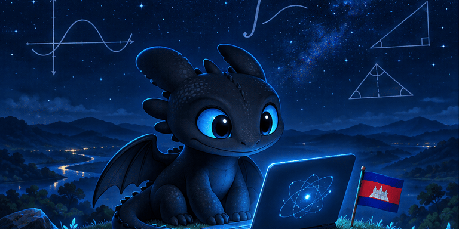

  

<h1>Welcomee! I'm Chhenghour 🇰🇭</h1>

<em>Learning deeply. Building with purpose.</em>

<h2>About Me </h2>

I'm a Cambodian computer science and mathematics student at <strong>De Anza College</strong>, interested in AI, software, and the mathematics behind them.

I like taking a question seriously enough to build something around it. Sometimes that starts with a frustrating housing search. Sometimes it starts with my own language. Other times, it’s simply wanting to understand how a computer solves a problem.

I’m still learning—and these projects are how I put that learning to work.

<h2>🐉 What I'm building</h2>

<table width="100%">
  <tr>
    <td width="32%" align="center" valign="middle">
      
    </td>
    <td width="68%" valign="top">
      <h3>🏠 <a href="https://www.sroknh.com">SrokNh · ស្រុកខ្ញុំ</a></h3>
      
<strong>A housing search with my father became a reason to build.</strong>

      
Searching for rentals in Phnom Penh meant visiting places that were too expensive, too far away, or already taken. That experience inspired me to start SrokNh, a rental housing platform for Cambodia.

      
As <strong>Founder and Product Lead</strong>, I guide product direction, design Khmer and English user flows, coordinate with engineers, and help troubleshoot releases.

      
<a href="https://www.sroknh.com">Visit SrokNh →</a>

    </td>
  </tr>
</table>

<table width="100%">
  <tr>
    <td width="68%" valign="top">
      <h3>🌾 <a href="https://github.com/Chhenghour-Ly/Willow-AI">Willow AI</a></h3>
      
<strong>Helping farmers find their next step after a disaster.</strong>

      
Our five-person team built a voice-powered assistant to help farmers discover disaster assistance and prepare crop-loss insurance notices.

      
I led research, product strategy, user experience, and the final pitch.

      
<strong>DA Hacks 5.0 — Top 6 finalist.</strong>

      
<a href="https://github.com/Chhenghour-Ly/Willow-AI">Explore Willow AI →</a>

    </td>
    <td width="32%" align="center" valign="middle">
      
    </td>
  </tr>
</table>

<table width="100%">
  <tr>
    <td width="32%" align="center" valign="middle">
      
    </td>
    <td width="68%" valign="top">
      <h3>⌨️ Sin Khmer Keyboard</h3>
      
<strong>Building for the language I grew up speaking.</strong>

      
An ongoing Romanized Khmer typing project with a <strong>C++ suggestion engine</strong> and an iPhone keyboard extension in development.

      
I'm exploring how to make everyday Khmer typing easier while learning about text processing, suggestion ranking, and native keyboard development.

    </td>
  </tr>
</table>

<!-- Sin Khmer Keyboard has no confirmed public URL yet. Add its canonical link when available. -->

<h2>🧠 What I'm exploring</h2>
<table width="100%">
  <tr>
    <td width="68%" valign="top">
      <h3>🧠 Mathematical Reasoning AI</h3>
      
I’m building an experimental AI project from scratch with guidance from a <strong>Stanford University mentor through Science Small Groups (SSG)</strong>. My work includes implementing a neuron, building an equation solver, and comparing numerical and symbolic approaches to investigate how systems solve mathematical problems—and where they fail.

    </td>
    <td width="32%" align="center" valign="middle">
      
    </td>
  </tr>
</table>

<h2>📚 Mathematics &amp; community</h2>
<ul>
  <li><strong>Singapore International Math Olympiad Challenge (SIMOC) — Honorable Mention</strong> One of four selected Cambodian student representatives.</li>
  <li><strong>Singapore and Asian Schools Math Olympiad (SASMO) — Silver Medal</strong></li>
  <li><strong>Vice President, Mathematics Club</strong></li>
  <li><strong>Vice President, Youth Council (Student Advisor &amp; Children’s Board Advisor)</strong></li>
</ul>

Mathematics has been a thread through my competitions, studies, and projects. Community work keeps me thinking about who those projects could help.

<h2>🛠️ Tools &amp; learning</h2>

  
  
  

<strong>Working with:</strong> C++, Git, GitHub, Nuxt, Vue, Supabase, and Vercel.

<strong>Currently learning:</strong> Python, AI fundamentals, algorithms, and iOS keyboard development.

Beyond software, I’ve repaired computers, run a small resale business, and created videos. Those experiences taught me to listen, work with constraints, and find another approach when the first one fails.

Outside of work: badminton, swimming, running, and singing.

<em>There’s plenty I don’t know yet. I keep asking, building, and trying again.</em>

<h3>Artwork &amp; inspiration</h3>

Dragon illustrations generated with AI, inspired by Toothless and the Night Fury from DreamWorks Animation’s <em>How to Train Your Dragon</em>, based on the book series by Cressida Cowell.

This is an unofficial fan-inspired personal profile, with no affiliation with or endorsement by DreamWorks Animation or the franchise’s rights holders. Existing characters and franchise elements belong to their respective owners.

